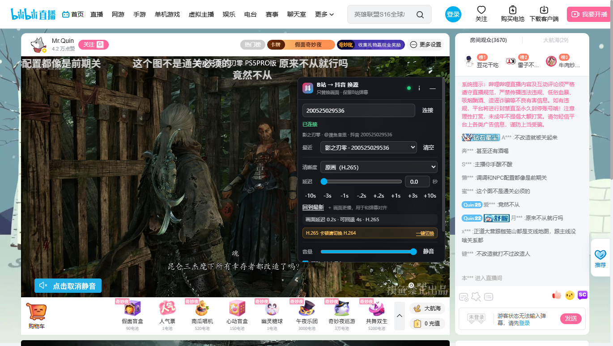
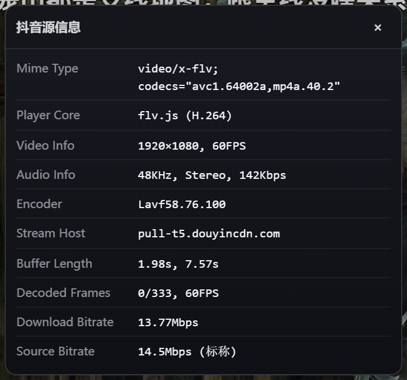

# BiliDouLiveSwapHub

一个 Chrome / Edge（Chromium）扩展：**把哔哩哔哩直播间的视频画面换成抖音直播间的画面，同时保留 B 站弹幕、聊天、礼物栏和播放器控件**。面板里可以调节延迟和快进/回退，用来把抖音画面与 B 站弹幕对齐。



> 截图：B 站直播间 `545318` 的画面来自抖音直播间 `200525029536`；面板清晰度为“原画（H.265）”，显示最近连接和“H.265 卡顿请切换 H.264”提示，标题栏 `i` 可打开抖音源信息；上方弹幕、右侧聊天、下方礼物栏和 B 站顶部导航都保持原样。

## 功能

- **只换视频画面**：在 B 站播放器内叠加抖音视频层，B 站弹幕、聊天、礼物、粉丝牌、播放器按钮都不受影响。
- 支持抖音直播间**链接、纯房间号、`v.douyin.com` 短链**。
- **最近连接**：自动保存连接过的抖音直播间（最多 12 个），面板“最近”下拉可快速重连；当前房间自动选中，支持“清空”。
- **H.265 卡顿提示**：选中原画（H.265）时显示“H.265 卡顿请切换 H.264”，并提供“一键切换”；切换到 H.264 原画后选择会记住。
- **H.265 自动保护**：H.265 持续低帧率或播放停滞时，先从 H.265 FLV 降级到 H.265 HLS，仍不稳定才切到 H.264 原画并提示；之后可随时重新选择 H.265 重试。
- **媒体信息面板**：点面板标题栏的 `i`，在播放器左上角查看当前抖音源的 Mime Type、Player Core、分辨率/帧率、音频参数、Encoder、Stream Host、缓冲长度、解码帧数、下载码率与源码率；开关状态会记住。
- 清晰度与抖音原生档位一致：**原画（H.265）**（约 15–17Mbps，优先连续 H.265 FLV，失败回退 H.265 HLS）/ **原画（H.264）**（约 14.5Mbps，FLV、低延迟、解码轻）/ **蓝光 1080P60**（约 9Mbps）/ **超清 720P60** / **高清 720P30** / **标清 540P25**；默认 H.265 原画，卡顿时可切 H.264 原画，选择会记忆。
- 同步控制：
  - 延迟目标 0–120 秒；
  - 快速微调 `-10s / -3s / -1s / -0.2s / +0.2s / +1s / +3s / +10s`；
  - 一键“回到最新”；
  - 面板实时显示“画面延迟”和“可回退”缓冲量。
- **自动重连**：播放中断后自动重新解析抖音流并恢复；拉流地址临近过期时会提前刷新。
- **防误暂停 / 自动续播**：不会把 B 站/Douyin 页面的空闲、后台、切清晰度等自动暂停同步给抖音画面；抖音画面被外部因素暂停时会自动恢复。
- **按 B 站房间记忆设置**：下次打开同一 B 站直播间会自动换源并恢复延迟。
- 音量控制；可跟随 B 站音量条。
- 面板可收起为小按钮；点击浏览器工具栏里的扩展图标也能展开/收起。

> **下载**：[GitHub Releases](https://github.com/hz121315/BiliDouLiveSwapHub/releases) · **问题反馈**：[Issues](https://github.com/hz121315/BiliDouLiveSwapHub/issues) · **源码**：[main](https://github.com/hz121315/BiliDouLiveSwapHub)

## 下载安装

### 方式一：安装 Release 压缩包（推荐）

1. 打开 [Releases](https://github.com/hz121315/BiliDouLiveSwapHub/releases) 页面。
2. 下载最新版本里的 `BiliDouLiveSwapHub-v1.4.2.zip`。
   - 如果 Release 暂时没有附加 zip，可在标签 `v1.4.2` 页面下载 **Source code (zip)**，或直接使用仓库 `release/BiliDouLiveSwapHub-v1.4.2.zip`。
3. 解压到一个固定目录，例如 `D:\BiliDouLiveSwapHub`。**不要直接加载 zip 文件**，Chrome/Edge 只认解压后的目录。
4. 打开解压目录，确认这一层能直接看到 `manifest.json`、`background.js`、`src/`、`vendor/`。如果解压后多套了一层 `BiliDouLiveSwapHub-v1.4.2/`，请进入这一层再加载。
5. Chrome 打开 `chrome://extensions`，Edge 打开 `edge://extensions`，开启右上角“开发者模式”。
6. 点击“加载已解压的扩展程序”，选择包含 `manifest.json` 的目录。
7. 打开任意 B 站直播间，例如 <https://live.bilibili.com/545318>，播放器右上角会出现 BiliDouLiveSwapHub 面板。
8. 建议在浏览器工具栏的扩展菜单里固定 BiliDouLiveSwapHub，点击图标可展开/收起面板。

压缩包解压后的结构应类似：

```text
BiliDouLiveSwapHub-v1.4.2/
├─ manifest.json
├─ background.js
├─ src/
│  ├─ content.js
│  ├─ douyin.js
│  └─ panel.css
├─ vendor/
├─ icons/
├─ licenses/
├─ README.md
├─ LICENSE
└─ THIRD_PARTY_NOTICES.md
```

**更新到新版本**

1. 下载新版本的 Release zip。
2. 解压并覆盖旧目录，保持加载路径不变。
3. 在扩展管理页点击本扩展的“重新加载”。
4. 刷新 B 站直播间页面。

> **不要直接选择 zip 文件**；必须解压后再“加载已解压的扩展程序”。
>
> **不要删除 `vendor/`**：flv.js、hls.js、mpegts.js 都在里面，删掉后无法播放抖音流。
>
> 更新后只刷新 B 站页面可能不够：浏览器会缓存后台 Service Worker，请务必先在扩展管理页点“重新加载”。

### 方式二：从源码加载（开发）

1. 克隆仓库：`git clone https://github.com/hz121315/BiliDouLiveSwapHub.git`
2. 用 Chrome 打开 `chrome://extensions`，或 Edge 打开 `edge://extensions`。
3. 打开右上角“开发者模式”。
4. 点击“加载已解压的扩展程序”，选择仓库根目录（包含 `manifest.json` 的那一层）。
5. 打开任意 B 站直播间，例如 <https://live.bilibili.com/545318>，播放器右上角会出现 BiliDouLiveSwapHub 面板。

更新源码后：在扩展管理页点击本扩展的“重新加载”，再刷新 B 站页面。

> 无需打包 crx，也无需构建步骤；`vendor/` 里的播放器库已经内置，不加载远程代码。

## 使用

1. 在面板输入抖音房间号，例如 `200525029536`，或粘贴完整链接 `https://live.douyin.com/200525029536`，点击“连接”。
2. 状态变成“已连接”后，播放器画面来自抖音；B 站弹幕仍然显示在画面上。
3. 连接成功会自动加入面板的“最近”列表；下次从“最近”下拉选择即可重连，点“清空”清除历史。
4. 调整同步：
   - **延迟滑块/数字**：目标延迟 = 画面落后抖音直播边缘的秒数。数值越大，画面越慢。
   - **`+` 按钮**：把画面往后压（更慢）。画面比 B 站弹幕“超前”时用。
   - **`-` 按钮**：把画面往直播边缘提前（更快）。画面比弹幕“滞后”时用。
   - **回到最新**：把画面跳到抖音直播最新位置。
   - 面板里的“画面延迟 X.Xs · 可回退 Ys”是实际延迟和当前可回退的缓冲量。
   - 刚连接或延迟大于已缓冲量时，画面中央会显示“缓冲 X/Ys”，等缓冲够了会自动开始播放。
5. 切换清晰度会重新建立抖音播放器，并自动恢复你设置的延迟。选中“原画（H.265）”时，面板会显示“H.265 卡顿请切换 H.264”，点“一键切换”即可改为 H.264 原画，选择会记住。
6. “恢复B站画面”随时回到 B 站原视频（同时恢复原视频的音量和显示）；再点“启用换源”可切回抖音。
7. 面板右上角“—”收起为小按钮；浏览器工具栏图标可以再展开。
8. 点面板标题栏的 `i` 打开“抖音源信息”，查看码率、分辨率、缓冲、解码帧数等；再点 `i` 或面板右上角 `×` 关闭，开关状态会记住。
9. 也可以在 B 站直播间 URL 后面加 `?douyin=抖音房间号` 自动换源，例如：
   <https://live.bilibili.com/545318?douyin=200525029536>

### 推荐的校准步骤

1. 先让抖音画面播放十几秒，确保“可回退”有足够缓冲。
2. 观察 B 站弹幕和抖音画面的对应关系。
3. 画面超前：连续点 `+0.2s` / `+1s`，直到和弹幕对上。
4. 画面滞后：点 `-0.2s` / `-1s`，把画面提前；如果已经到“回到最新”位置，说明抖音源本身比弹幕慢，无法再提前。
5. 延迟值会按 B 站房间保存，下次进入自动恢复。

### 清晰度与画质

- 档位与抖音原生菜单一致：**原画、蓝光、超清、高清、标清**。
- 清晰度下拉里有两个原画档：
  - **原画（H.265）**：抖音原生 H.265，1920×1080、60fps，约 15–17Mbps；优先播放 `web_stream_url` 里的 H.265 原画 FLV（连续流、低延迟），FLV 不可用或卡顿时自动改用 H.265 HLS；
  - **原画（H.264）**：H.264 原画，1920×1080、60fps、约 14.5Mbps，FLV 连续流、延迟低、解码轻；清晰度低于 H.265，适合 H.265 确实无法流畅播放时使用。
- 选中原画（H.265）时，面板会显示 **“H.265 卡顿请切换 H.264”** 和“一键切换”按钮；切换后会记住 H.264 选择，H.265 提示自动隐藏。
- 1.3.3 起增加 **H.265 自动保护**：H.265 播放 10 秒后，如果连续出现低于 40fps 或反复停滞/加载失败，会先尝试 H.265 HLS；HLS 仍不稳定时再切到 H.264 原画并在状态栏提示。设备/网络足够时 H.265 会保持；之后可重新选 H.265 重试。
- H.265 原画 FLV 由 mpegts.js 的 FLV/HEVC 解封装播放，是连续流，不需要等 4 秒 HLS 分片；H.265 HLS 作为兜底，会预取 2 个分片（约 8 秒）并流式读取，降低分片到达时的抖动。H.264 原画使用 FLV，更接近直播边缘。
- 实测同一房间每 4 秒的流大小：
  - **H.265 HLS 原画**：约 8.7MB / 4s ≈ **17.4Mbps**（随场景波动），HEVC Main 4.1，1920×1080、60fps；H.265 FLV 原画是同一档的连续流封装；
  - **H.264 原画** `_or4.flv`：约 7.2MB / 4s ≈ **14.5Mbps**，H.264，1920×1080、60fps；
  - **蓝光** `_uhd.flv`：约 4.5MB / 4s ≈ **9Mbps**，H.264，1920×1080、60fps。
- 旧版扩展把 `FULL_HD1/_uhd`（蓝光）标成“原画/蓝光”并默认使用，所以同分辨率下码率只有真原画的一半左右，看起来更糊。这**不是登录态问题**：匿名的 SSR 页面数据里已经包含原画地址，测试确认可以直接拉流。
- 抖音页面的 `default_resolution` 常常是 HD1（720P），并不代表最高画质；扩展按 `live_core_sdk_data` 的等级/分辨率排序，并从完整 `stream_data` 提取原画/H.265 地址。
- 抖音原生页面可能出现“原画试看 27s，登录可无限”的提示；这是页面层的试用限制。扩展只解析页面里的签名流地址，不读取或使用账号凭证（见权限说明）。
- 如果某个房间确实把原画只开放给登录用户、页面完全不暴露地址，扩展只能使用页面实际提供的最高清晰度。

### 媒体信息面板

点面板标题栏的 **`i`**，可在播放器左上角展开“抖音源信息”（参考 B 站播放器自带的媒体信息样式）：



- **Mime Type / Player Core**：实际使用的封装/编码与播放核心——`flv.js` 播放 H.264 FLV，`mpegts.js` 播放 H.265 HLS/TS，`hls.js` 播放 HLS。
- **Video Info / Audio Info**：分辨率、帧率、音频采样率、声道和音频码率。
- **Encoder**：流元数据中的编码器信息；部分 H.265 直播流没有该字段时显示“—”。
- **Stream Host**：当前拉流的抖音 CDN 域名。
- **Buffer Length**：当前播放位置之后的缓冲秒数，以及 MSE 中保留的总缓冲秒数。
- **Decoded Frames**：丢弃帧数 / 总解码帧数，以及最近 1 秒的实测帧率；H.265 卡顿时这个帧率会明显低于 60。
- **Download Bitrate**：播放器上报的实时下载码率。HLS 每 4 秒拉一次分片，峰值会高于平均码率，扩展会短暂保留上次数值避免显示闪烁。
- **Source Bitrate**：当前档位的标称源码率（来自抖音流元数据或档位配置），不是实时值。

再点 `i` 或面板右上角的 `×` 关闭；开关状态会保存，下次打开 B 站直播间保持上次选择。

## 工作原理

- **后台抓流**：`background.js` 在扩展 Service Worker 中请求 `https://live.douyin.com/<房间号>` 的 SSR HTML，从 `roomInfo.room.stream_url` 中解析 FLV/HLS 拉流地址。该方法不依赖抖音的签名接口（`a_bogus` 等），通常也不需要登录。
- **叠加播放**：`src/content.js` 在 B 站 `#live-player` 内插入 `z-index: 2` 的视频层；B 站弹幕层 `.web-player-danmaku` 是 `z-index: 10`，播放器控件是 `z-index: 13`，因此弹幕和控件始终在抖音画面之上。
- **保留 B 站原视频**：把 B 站原视频设为 `opacity: 0`（而不是 `visibility: hidden`，这样点击仍能命中原视频）并压掉原声，原视频继续播放。跟随音量时优先通过 Web Audio 零增益通道消音，让 B 站控件显示真实的音量/静音状态；音频路由不可用时回退为原视频静音。只把 B 站播放/暂停按钮（或快捷键）产生的**用户主动暂停**同步给抖音画面；页面空闲、后台、切换清晰度等自动暂停会被忽略，并会尝试恢复 B 站原视频。抖音画面自身被意外暂停时有自动续播看门狗。
- **播放器**：原画优先用内置 mpegts.js 播放 H.265 原画 FLV（连续流），FLV 不可用/卡顿时回退 mpegts.js 播放 H.265 HLS(TS)，浏览器不支持 HEVC 时再回退 flv.js 播放 H.264 原画 FLV；蓝光/超清等用 flv.js；其他 HLS 用 hls.js。抖音 CDN 支持 HTTPS 和 `Access-Control-Allow-Origin: *`，所以页面里的播放器可以直接拉流。
- **延迟算法**：目标位置 = 直播边缘 − 目标延迟。缓冲不足时暂停等待缓冲增长，够用后 seek 到目标位置；之后只在漂移超过阈值时校正，避免频繁 seek 造成卡顿。flv.js 默认保留约 3 分钟缓冲，因此 0–120 秒延迟都在可回退范围内。
- **不影响 B 站其他功能**：只改播放器内的视频层，不替换 B 站播放器、不改 B 站网络请求，弹幕、聊天、礼物、粉丝牌等继续工作。

## 目录

```text
.
├─ manifest.json              # MV3 清单
├─ background.js              # 后台：抓取/解析抖音直播间
├─ src/
│  ├─ douyin.js               # 抖音页面解析（roomInfo / stream_url）
│  ├─ content.js              # 视频叠加、延迟同步、面板逻辑
│  └─ panel.css               # 面板与视频层样式
├─ vendor/
│  ├─ flv.min.js              # flv.js 1.6.2
│  ├─ hls.min.js              # hls.js 1.5.17
│  └─ mpegts.js               # mpegts.js 1.8.2
├─ icons/                     # 扩展图标
├─ docs/
│  ├─ screenshot.png          # 使用效果
│  └─ media-info.png          # 抖音源信息面板
└─ licenses/Apache-2.0.txt
```

## 常见问题

**面板没有出现？**

- 确认页面是 `https://live.bilibili.com/<房间号>`，不是首页/活动页。
- 在扩展管理页确认扩展已启用，然后刷新页面。
- 打开浏览器控制台，过滤 `[BDS]` 看内容脚本是否加载。

**提示“抖音直播间不存在或当前未开播”？**

- 检查抖音房间号是否正确，以及对方是否正在直播。
- 抖音页面可能要求人机验证：点面板里的“打开抖音页”，在抖音页面完成验证后，回 B 站点“重连”。

**提示安全验证 / 没有拉到流？**

- 先在同一浏览器的抖音直播间页面完成验证（滑块/点选），保留 Cookie，再回 B 站重连。
- 抖音可能临时限制抓取；稍后再试，或换一个抖音直播间验证扩展是否正常。

**画面一直缓冲 / 黑屏？**

- 等几秒；加大延迟需要积累缓冲。
- 换一个清晰度（原画/蓝光/超清/高清/标清）试试。
- 点“重连”；如果仍失败，检查控制台 `[BDS]` 错误。

**没有声音？**

- 浏览器可能拦截了自动播放声音：点一下页面或点面板“取消静音”。
- 检查面板音量是否为 0；如果开启了“跟随B站音量条”，B 站音量条也会同步。
- 抖音画面使用抖音音频；B 站原视频始终静音。

**放一段时间不操作会暂停吗？**

不会因为“长时间不操作”而暂停：

- 扩展**没有加载抖音网页**，只拉抖音 CDN 的 FLV/HLS 流，所以抖音网页版的“长时间不操作暂停”不会作用于扩展。
- B 站播放器/浏览器在空闲、后台或切换清晰度时如果自动暂停了原视频，扩展不会把这个暂停同步给抖音画面，并会尝试让 B 站原视频恢复播放；抖音画面被外部因素暂停时也会自动续播。
- 主动暂停请点 **B 站播放器左下角的暂停按钮**（B 站直播点击画面本身本来就不会暂停）。系统媒体键、部分第三方播放控制触发的暂停可能被当作“自动暂停”而忽略，这是为了防止空闲暂停。
- 切到后台再回来时，扩展会检查并恢复播放/延迟。

**画面还是不如抖音直播间清晰？**

- 先确认面板“清晰度”是 **原画**，并且面板延迟行末尾有 `H.265 FLV` 或 `H.265 HLS`。1.4.0 起原画优先走 H.265 FLV；如果没有 H.265 标记，说明浏览器不支持 HEVC MSE，已自动回退到 H.264 原画（约 14.5Mbps）。
- 原生抖音页面用的是 H.265 原画（约 15–17Mbps）；扩展现在优先用同一档 H.265 FLV，画质应对齐。旧版的蓝光/720P 问题已修复。
- 如果仍觉得糊：把 B 站播放器放大/网页全屏后再比；B 站布局有聊天栏，播放器比抖音全宽播放器小。
- H.265 原画优先使用连续 FLV，延迟接近原生；FLV 不可用或卡顿时才回退到 4 秒 HLS 分片，此时延迟会略高。
- 登录不是画质原因；匿名页面已有签名原画地址，扩展不读取账号凭证。

**为什么一卡一卡的？**

- H.265 原画是约 15–17Mbps 的 FLV/HLS 流，部分设备没有硬件 HEVC、或网络刚好够用时会解码/带宽吃紧，表现为规律卡顿。测试环境无硬件 HEVC 时 H.265 只有约 7–11fps，而同样内容的 H.264 能到 60fps。
- 1.3.3 起 H.265 有**自动保护**：连续低于 40fps 或反复停滞/加载失败时，先从 H.265 FLV 降到 H.265 HLS；仍不稳定才切到 H.264 原画并提示，长看不会一直卡；之后可在清晰度里重新选 H.265 重试。
- 首选处理：点面板上的 **“H.265 卡顿请切换 H.264” → “一键切换”**，或直接在清晰度里选 **原画（H.264）**。它是 14.5Mbps 的 FLV 连续流，解码轻、延迟低，通常会立刻变流畅；选择会记住。
- 同时把 **B 站原视频清晰度调到最低**（流畅/标清）。B 站原视频仍在后台播放以保持播放器状态，会额外占用带宽和解码；弹幕/聊天/礼物不受影响。
- 确认网络能稳定跑 15–18Mbps。H.265 的 15–17Mbps 加上 B 站原视频的流量会叠加，接近或超过带宽上限就会卡。
- H.265 HLS 回退已预取 2 个分片（约 8 秒）+ 流式读取，缓冲更稳；但硬解/带宽不足时仍建议 H.264 原画。
- 如果 H.264 原画也卡，优先降低 B 站原视频清晰度或检查网络；H.264 原画本身只要求约 15Mbps。

**B 站弹幕被挡住了吗？**

正常情况下不会：弹幕层 `z-index: 10` 在抖音视频层 `z-index: 2` 之上。如果 B 站改版导致层级变化，需要同步更新 `src/content.js` 里的 `ensureLayer` 和 `src/panel.css`。

**全屏后抖音画面不见了？**

B 站的“网页全屏”和容器全屏会带着扩展的叠加层一起显示。如果某种模式只全屏了原始 `<video>` 元素，扩展会尝试退出该全屏并改为全屏播放器容器；若浏览器拒绝，按 `Esc` 后重新点全屏。

**恢复B站画面后音量/画面不对？**

扩展会恢复接管前的 `opacity`、`muted`、`volume` 和暂停状态。若 B 站播放器自身状态异常，刷新页面即可。

**为什么网络流量变大了？**

为了保留 B 站的播放器状态、弹幕时间轴和控件，B 站原视频仍在后台静音播放；因此会同时下载 B 站原流和抖音流。可以把 B 站清晰度调低来减少流量，卡顿时也建议调低。

**刷新/更新扩展后要做什么？**

- 在扩展管理页点“重新加载”，然后刷新 B 站直播间。
- **只刷新 B 站页面可能不够**：浏览器可能缓存旧的后台 Service Worker，导致面板仍显示旧的清晰度标签或默认画质。
- 旧版本保存的设置会在下次连接时自动迁移：旧的自动/最高档（FULL_HD1）会切到原画；你明确选过的较低清晰度会保留。

## 已知限制

- 仅适配 B 站**直播间播放器**（`#live-player`）；点播、首页活动页不适用。
- 延迟只能加、不能减到抖音直播边缘之前；原画 H.265 FLV/HLS、H.264 FLV 最大 120 秒，且受当前缓冲量限制。
- 原画优先 H.265（需要浏览器支持 HEVC MSE）；不支持时自动回退 H.264 原画（约 14.5Mbps）。H.265 优先连续 FLV；回退到 HLS 时为 4 秒分片并预取约 8 秒，延迟略高；H.264 原画是连续 FLV，更接近直播边缘。
- H.265 对解码和带宽要求更高；优先使用 H.265 原画 FLV，失败/卡顿时自动回退 H.265 HLS，仍不稳定才切 **原画（H.264）**。设备无硬件 HEVC 时只能使用 H.264，清晰度会低于抖音原生 H.265。
- HLS 回退源的延迟能力受直播播放列表和缓冲策略限制，建议把延迟控制在 60 秒以内；正常会优先使用 H.265 原画或 H.264 原画/蓝光 FLV。
- 抖音源只有 H.265 且没有可用的 FLV/HLS、浏览器也不支持 HEVC 时，无法播放，会回退或报错。
- B 站的画中画、截图、录屏、部分播放统计读取的是 B 站原始视频流，画面区域显示的是抖音画面。
- 抖音页面结构/风控策略可能变化；如果解析失败，需要更新 `src/douyin.js`。
- B 站自身出现滑块/点选验证码时，与扩展无关，完成验证即可。
- 为了防误暂停，扩展只识别 B 站播放器播放/暂停按钮和键盘快捷键产生的暂停；系统媒体键、第三方播放控制触发的暂停可能被忽略，画面会继续播放。
- 最高清晰度取决于抖音页面实际暴露的清晰度列表；部分房间可能把更高清晰度限制给登录/特定用户。
- 需联网使用；不包含任何账号、Cookie 或代理服务。

## 更新记录

- **1.4.0**：H.265 原画优先使用 `web_stream_url` 的无后缀 H.265 FLV（连续流、低延迟），由 mpegts.js 的 FLV/HEVC 解封装播放；FLV 失败或卡顿时自动回退 H.265 HLS，再回退 H.264 原画；状态提示不再被“已连接”覆盖。
- **1.3.4**：新增“抖音源信息”面板（面板标题栏 `i` 开关）：显示 Mime Type、Player Core、视频/音频参数、Encoder、Stream Host、Buffer Length、Decoded Frames、下载码率与标称源码率；开关状态记忆；H.265 与 H.264 两种播放核心均接入统计。
- **1.3.3**：新增 H.265 自动保护：连续低帧率（<40fps）或反复停滞/加载失败时自动切换到 H.264 原画并提示，避免长时间观看时持续卡顿；可重新选择 H.265 重试。
- **1.3.2**：新增最近连接过的抖音直播间列表（最多 12 个，面板“最近”下拉快速重连/清空）；选中 H.265 原画时显示“H.265 卡顿请切换 H.264”提示，并支持一键切换到 H.264 原画。
- **1.3.1**：新增“原画（H.264）”平滑档（14.5Mbps、FLV、低延迟）以解决 H.265 卡顿；H.265 HLS 改为预取 2 个分片 + 流式读取；面板清晰度可选择并记忆；README 增加卡顿处理说明。
- **1.3.0**：原画优先 H.265（mpegts.js + 自实现 HLS/TS 直播加载器，约 17.4Mbps、1080P60）；不支持 HEVC 时自动回退 H.264 原画；延迟行显示 H.265；新增 mpegts.js 依赖与许可。
- **1.2.0**：接入原画 `_or4.flv`（约 14.5Mbps）并设为默认；清晰度档位与抖音原生菜单一致（原画/蓝光/超清/高清/标清）；原画 FLV 失败时自动回退 HLS/蓝光；旧最高档/自动设置迁移到原画；HLS 起播更稳并增加错误日志。
- **1.1.0**：默认自动选择最高清晰度；清晰度标签显示真实分辨率/帧率/码率；旧 HD1 设置自动迁移；新增防误暂停/自动续播。
- **1.0.0**：初始版本（换源、延迟同步、清晰度切换、自动重连）。

## 开发与调试

- **纯静态扩展**，没有构建步骤。修改后直接“重新加载”扩展即可。
- 音频控制回归测试使用 Node.js 18 或更新版本自带的测试运行器，无需安装依赖：`node --test`。覆盖音量/静音同步、自动播放解锁、原视频恢复及音频路由不可用时的回退。
- 解析器 `src/douyin.js` 不依赖 DOM，可在 Node 中单独测试：
  ```js
  require('./src/douyin.js');
  const html = '...抖音直播间 HTML...';
  console.log(globalThis.BDSDouyin.parseRoomHtml(html, '200525029536'));
  ```
- 内容脚本会在 `#bds-root` 上维护 `data-bds-status`、`data-bds-active`、`data-bds-delay`、`data-bds-latency`、`data-bds-quality`、`data-bds-quality-auto`、`data-bds-engine` 等属性，方便在 DevTools 里观察状态。
- 控制台过滤 `[BDS]` 可看到内容脚本日志；后台日志在 `chrome://extensions` 本扩展的“Service Worker”控制台。
- 也可以给 B 站直播间 URL 加 `?douyin=<房间号>` 来跳过手动输入，便于调试。

## 发布 Release（维护者）

1. 修改 `manifest.json` 里的 `version`，并同步更新 README 更新记录。
2. 打包时把 `manifest.json` 放在压缩包根目录，至少包含：
   `manifest.json`、`background.js`、`src/`、`vendor/`、`icons/`、`licenses/`、`LICENSE`、`THIRD_PARTY_NOTICES.md`、`README.md`。
3. 压缩包命名建议：`BiliDouLiveSwapHub-v<版本号>.zip`，例如本仓库的 `release/BiliDouLiveSwapHub-v1.4.2.zip`。
4. 在 GitHub 仓库的 **Releases → Draft a new release**：
   - Tag：`v1.4.2`（与 manifest 版本一致）；
   - Title：`BiliDouLiveSwapHub v1.4.2`；
   - 上传 `BiliDouLiveSwapHub-v1.4.2.zip` 作为 Release asset；
   - 填写更新说明后发布。
5. 发布后，README 里的 [Releases](https://github.com/hz121315/BiliDouLiveSwapHub/releases) 链接即可直接下载压缩包。

> Release zip 的根目录必须是 `manifest.json` 所在目录；不要把整个仓库再套一层后上传，否则用户解压后容易选错加载目录。

## 权限说明

- `storage`：按 B 站房间保存抖音房间号、延迟、清晰度、音量等设置。
- `https://live.douyin.com/*`、`https://v.douyin.com/*`、`https://*.douyin.com/*`、`https://douyin.com/*`：后台抓取抖音直播间页面与短链跳转。
- 不申请 B 站主机权限；内容脚本仅通过 `content_scripts.matches` 注入 `https://live.bilibili.com/*`。
- 不收集数据，不加载远程代码，`flv.js` / `hls.js` / `mpegts.js` 均已内置在 `vendor/`。

## 第三方组件

- [flv.js](https://github.com/bilibili/flv.js) v1.6.2 — Apache-2.0
- [hls.js](https://github.com/video-dev/hls.js) v1.5.17 — Apache-2.0
- [mpegts.js](https://github.com/xqq/mpegts.js) v1.8.2 — Apache-2.0

详见 [THIRD_PARTY_NOTICES.md](THIRD_PARTY_NOTICES.md) 和 [licenses/Apache-2.0.txt](licenses/Apache-2.0.txt)。

## 免责声明

本项目仅供个人学习、研究与技术交流使用。请遵守哔哩哔哩、抖音及相关内容权利方的服务条款和版权规定；不得用于商业传播、绕过付费/权限限制或其他侵权用途。使用本扩展产生的后果由使用者自行承担。

## License

本项目自身代码采用 MIT License，见 [LICENSE](LICENSE)；第三方组件遵循其各自许可证。
